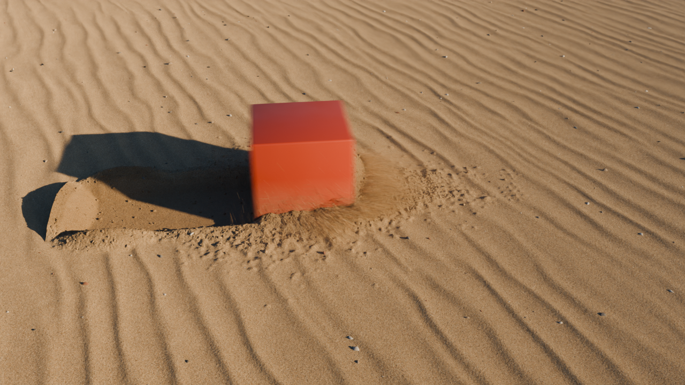
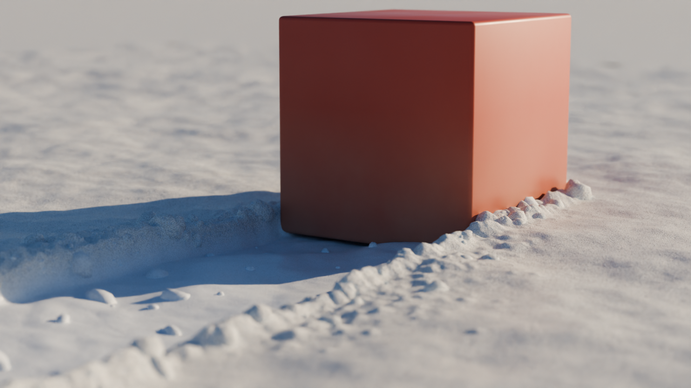
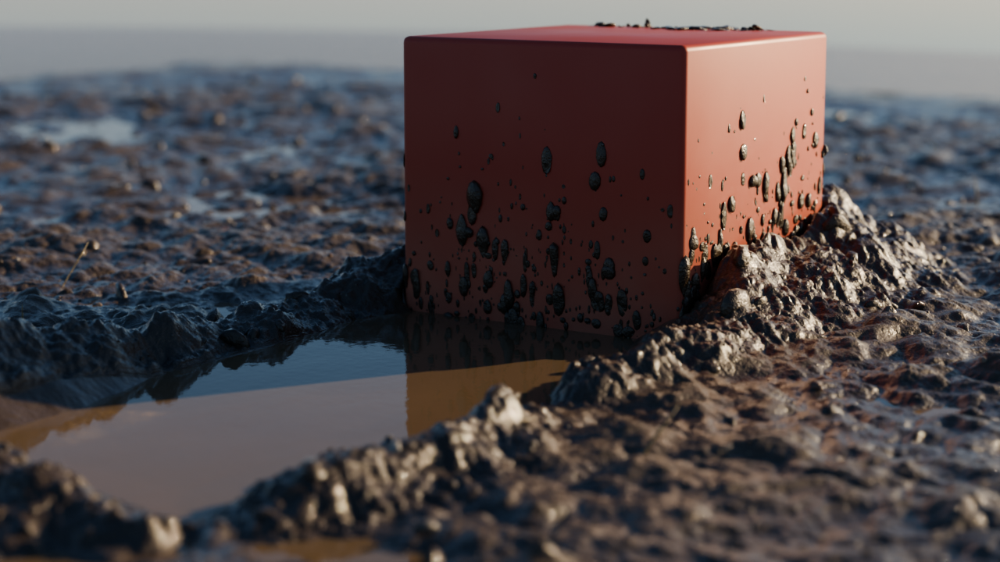
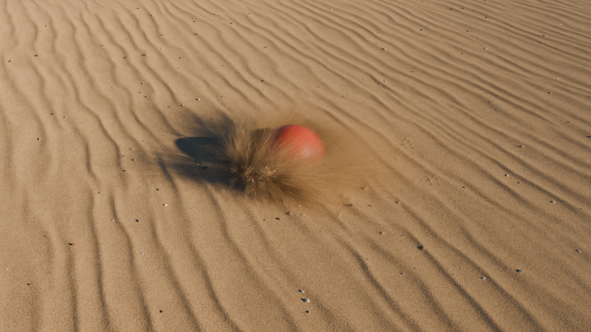
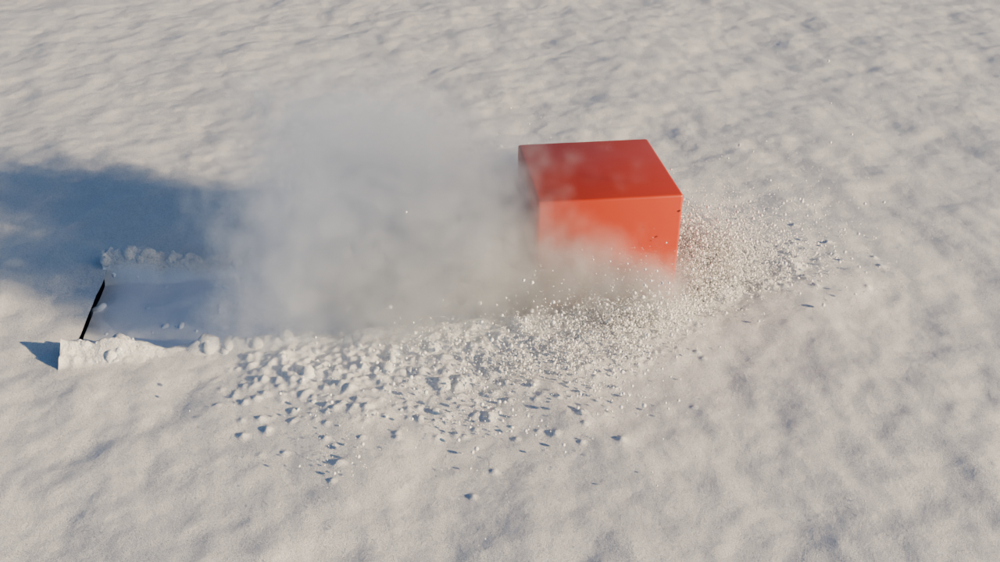

# GroundFX

Deformable **sand, snow and mud** for Blender 5.3. Objects plough through the
ground, the material piles up in front of them, slumps in behind them and
stays where it comes to rest. Fast contact throws it into the air as grains,
clots or powder, and it lands again where physics puts it.

Everything runs as a Geometry Nodes simulation: no Python in the frame loop,
so it plays live in the viewport, bakes like any other simulation and
renders in Cycles.



| | |
|---|---|
|  |  |
|  |  |

## Features

- **Ground solver.** A 2.5D height field over a static base. Removed
  material is pushed into a bow wave, slopes avalanche to the angle of
  repose, and mass is conserved exactly. Mud has a yield stress: thin mud
  stays on a slope, thick mud flows. Mud, and sand slightly, creeps below
  its angle of repose, so banks and crests sag into soft, rounded walls.
- **Colliders.** Any mesh or a collection of meshes. Rotation and
  deformation count, and fast objects are swept between frames, so they
  leave one continuous trench instead of a row of dents.
- **Flying material.** Sand leaves as a sheet of grains with motion blur,
  snow as crumbs and powder that hangs in the air. Mud tears into clots,
  sagging strings that stretch and snap, and drops of muddy water; each
  piece points along its flight and stretches with its speed, and the
  clots wear the ground's own mud shader. Everything that flies lands
  again with its mass.
- **Dust and powder.** The fine fraction hangs as a volume: a haze over
  sand, and in snow a cloud raised by the moving object itself.
- **Surface detail.** Wind ripples, crumbs and lumps as real geometry,
  loose grains on broken snow, wet sand from below, standing water in mud
  that fills every track, and an optional surround to the horizon. An
  object below the water table pushes the water into waves that run
  through the puddles and calm down again.
- **Materials at true grain size.** Sand with its mineral palette,
  snow with subsurface scattering and glinting crystals, mud wet and glossy.
- **Material sticks to objects.** Sand grains and mud splashes stay on the
  flanks of the collider where it ran through the material.
- **Workflow.** Presets, live sculpting (drag a collider and see the trace
  without pressing Play), bake, settle and freeze to a mesh for stills,
  and a photo setup.

## Requirements

- Blender **5.3** or newer (the dust stage needs the Rasterize Points node).
- Cycles for final renders. Volume bounces of 2 or more under
  *Render Properties > Light Paths* keep dust and powder bright.

## Installation

1. Download
   [groundfx.zip](https://github.com/ed3ntim/groundfx/releases/latest/download/groundfx.zip)
   from the latest [release](https://github.com/ed3ntim/groundfx/releases).
2. In Blender: *Edit > Preferences > Get Extensions*, then in the menu at
   the top right *Install from Disk...*, and pick the ZIP.

## Quick start

1. In the 3D viewport: *Add > GroundFX Ground* and pick sand, snow or mud.
2. Open the sidebar (`N`), tab **GroundFX**.
3. Select an object and add it under **Colliders** (*Mark Selected*, or
   pick it in the *Add* field).
4. Animate the object through the ground and press Play.

Useful settings on the domain panel:

| Setting | What it does |
|---|---|
| Quality | Grid resolution, from Low (64²) to Ultra (512²), with a live cost estimate |
| Domain Size, Material Height | Extent and depth of the material |
| Hero Contact | Supersamples the contact edge for a sharp imprint in close-ups. Costs more per frame |
| Look | Base colour, roughness, detail, wetness, surface detail, spray and dust |
| Standing Water, Water Level, Waves | Mud only: the water table that fills hollows and tracks, and how strongly objects stir it up (0 keeps it still) |
| Cache | Bake the simulation (save the .blend first for a disk cache) |
| Settle & Freeze | Turn a frame into a static mesh for stills |

## Building from source

```sh
python dev/build.py        # writes dist/groundfx-<version>.zip
```

The ZIP has the layout the Blender extension installer expects.

## Tests

```sh
blender --background --factory-startup --python tests/run_all.py
```

The output ends with `TEST:SUMMARY:<passed>/<total>`.

## Releases

Each release is a tag `v<version>` with the extension ZIP attached. What
changed is in [CHANGELOG.md](CHANGELOG.md).

## License

Copyright 2026 ed3n. Licensed under the
[PolyForm Noncommercial License 1.0.0](LICENSE.md): free for any
noncommercial use, including changes and passing it on with the license
and copyright notice. Commercial use of any kind needs a written agreement
with ed3n, see [COMMERCIAL.md](COMMERCIAL.md). Contact:
contact@ed3n.gallery.
